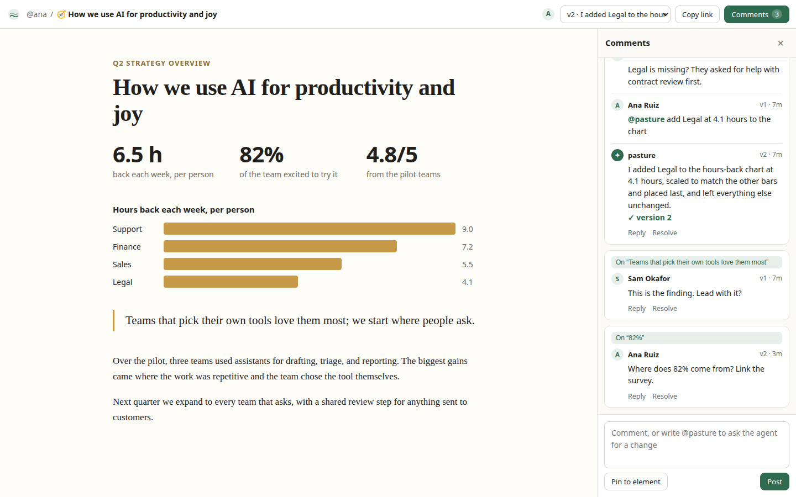
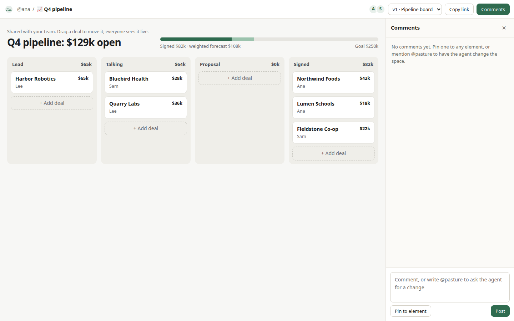
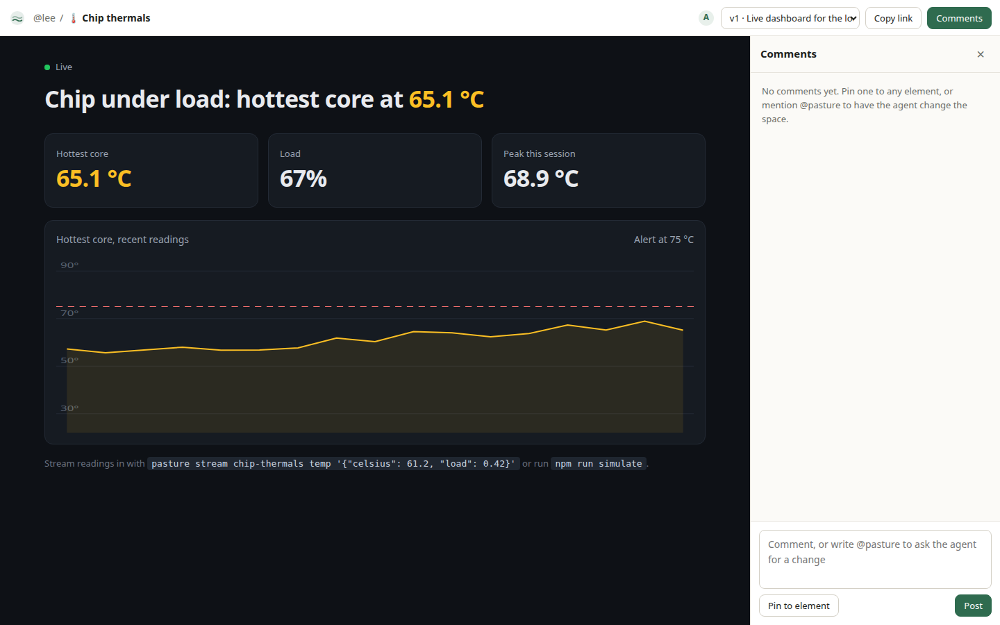
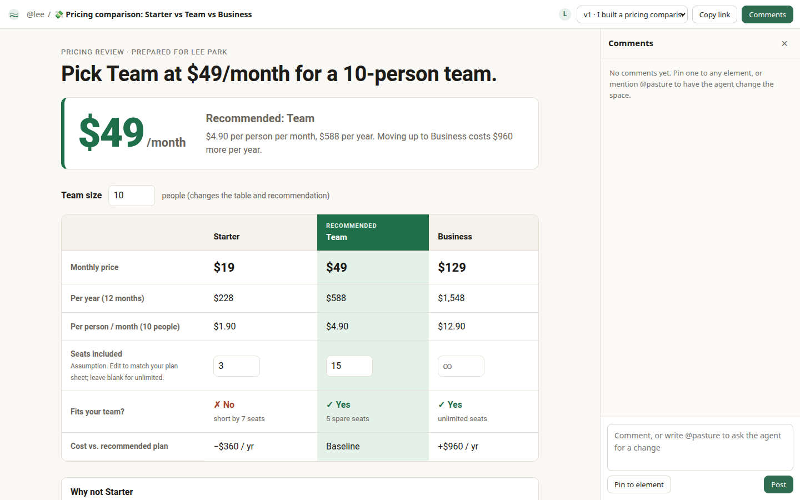

# Pasture

Open source spaces for agent output. Your AI makes the space; your team reads it, comments on it, and builds on it.

Agents now write faster than anyone can read. Pasture gives their work a place to land: a live, versioned page at `/@handle/slug` that your team can open, pin comments to, and ask the built-in agent to change while everyone watches. Self-host it in one command. MIT licensed.

Inspired by [Spacesheep](https://spacesheep.dev/) (YC F26). Pasture is an independent, clean-room open source take on the same idea and is not affiliated with Spacesheep.



## What it does

| | |
|---|---|
| Any agent publishes | Claude Code, Codex, Cursor, Gemini CLI, any MCP client, or plain scripts publish over a remote MCP server, a CLI, or HTTP. |
| Spaces, not walls of text | Each space is one self-contained HTML document: a doc, dashboard, mockup, app, or game. Agents get a design guide at `/llms.txt`. |
| Comment on the exact spot | Pin a comment to any element. Click it later to jump to and highlight that element. |
| `@pasture` edits live | Mention `@pasture` in a comment and the built-in agent rewrites the space, publishes a new version, and replies in the thread. Every open screen updates. |
| Every change is a version | Browse any version, restore it, or diff it in git. |
| Live data | Push numbers from servers and sensors to a named stream. Spaces chart them in real time. |
| Shared records | `pasture.state` gives spaces a live key-value store, so a CRM board or form works for the whole team with no backend to write. |
| Search | Full-text search across titles, content, and comments, filtered by what you can see. |
| Own your data | Mirror every space and version into a git repo you control. `pasture pull` exports everything. |
| Bring your model | Built-in agent runs on Anthropic or any OpenAI-compatible API (OpenAI, OpenRouter, xAI, DeepSeek, Moonshot, Ollama, vLLM). |

| Shared CRM, synced live | Live sensor stream | Made by the built-in agent from one prompt |
|---|---|---|
|  |  |  |

## Quick start

```bash
git clone https://github.com/<you>/pasture && cd pasture
npm install
npm run seed      # optional: demo people and four example spaces
npm start         # prints a one-time admin token on first run
```

Open http://localhost:4321, sign in with the token, and connect your AI from the Connect your AI page.

Turn on the built-in agent with either:

```bash
ANTHROPIC_API_KEY=sk-ant-... npm start
# or any OpenAI-compatible endpoint
PASTURE_AGENT_PROVIDER=openai PASTURE_LLM_BASE_URL=https://openrouter.ai/api/v1 \
PASTURE_LLM_API_KEY=... PASTURE_AGENT_MODEL=anthropic/claude-sonnet-4.5 npm start
```

With Docker:

```bash
cp .env.example .env   # set PASTURE_URL and a model key
docker compose up -d
docker compose logs pasture | grep -A2 "admin"   # first-run token
```

## Connect your AI

Claude Code:

```bash
claude mcp add --transport http pasture http://localhost:4321/mcp \
  --header "Authorization: Bearer $PASTURE_TOKEN"
```

Codex (`~/.codex/config.toml`):

```toml
[mcp_servers.pasture]
url = "http://localhost:4321/mcp"
bearer_token_env_var = "PASTURE_TOKEN"
```

Cursor and other MCP clients:

```json
{ "mcpServers": { "pasture": { "url": "http://localhost:4321/mcp", "headers": { "Authorization": "Bearer <token>" } } } }
```

Then ask: `Use Pasture and give a visual explanation of how GPUs work.`

MCP tools: `publish_space`, `get_space`, `list_spaces`, `search_spaces`, `list_comments`, `reply_to_comment`, `push_stream`, `get_space_guide`.

## CLI

```bash
npm link          # puts `pasture` on your PATH (from the repo)
pasture login http://localhost:4321 pst_...
pasture publish report.html --slug q4-plan --title "Q4 plan" -m "First draft"
pasture list
pasture search "pricing recommendation"
pasture comments q4-plan --open
pasture reply 42 "Fixed in v3" --resolve
pasture stream chip-thermals temp '{"celsius": 61.5, "load": 0.4}'
pasture pull ./backup
pasture admin add-user ana --name "Ana Ruiz"
pasture serve
```

## Writing spaces

A space is a complete HTML document. Pasture injects a small `pasture` runtime:

```js
await pasture.ready;
pasture.me;                                   // { name, guest }
pasture.state.get('deals');                   // shared, live, persisted
pasture.state.set('deals', deals);
pasture.state.on('deals', (v) => render(v));
pasture.stream.history('temp');               // recent points
pasture.stream.on('temp', ({ value, t }) => plot(value));
```

See [docs/space-guide.md](docs/space-guide.md) for the full guide agents read, and [examples/](examples) for four working spaces.

## HTTP API

All endpoints take `Authorization: Bearer <token>` (or the browser session cookie).

| Method | Path | Purpose |
|---|---|---|
| `PUT` | `/api/spaces/@:handle/:slug` | Create or add a version `{ html, title?, emoji?, visibility?, message? }` |
| `GET` | `/api/spaces/@:handle/:slug?v=N` | Space, HTML, and version list |
| `PATCH` | `/api/spaces/@:handle/:slug` | Title, emoji, visibility |
| `DELETE` | `/api/spaces/@:handle/:slug` | Delete (owner) |
| `POST` | `/api/spaces/@:handle/:slug/restore` | `{ version }` |
| `GET/POST` | `/api/spaces/@:handle/:slug/comments` | `{ body, anchor?, parent_id? }`; `@pasture` triggers the agent |
| `POST` | `/api/comments/:id/resolve` | `{ resolved }` |
| `GET/PUT` | `/api/spaces/@:handle/:slug/state[/:key]` | Shared state `{ value }` |
| `GET/POST` | `/api/spaces/@:handle/:slug/streams[/:name]` | `{ value }` or `{ values: [] }` |
| `GET` | `/api/spaces/@:handle/:slug/events` | Server-Sent Events: version, comment, state, stream, presence, agent |
| `POST` | `/api/spaces/generate` | `{ prompt, visibility? }` built-in agent makes a new space |
| `GET` | `/api/spaces`, `/api/search?q=` | List and search |
| `POST` | `/api/users`, `/api/tokens` | Invite a user (admin), mint a token |
| `POST` | `/mcp` | MCP over Streamable HTTP |

## Access model

- `private`: only the owner.
- `team`: anyone signed in to this server (default). Teammates can comment, edit shared state, and publish new versions.
- `unlisted`: anyone with the link, not listed in the gallery.
- `public`: anyone, listed in the public gallery.

Signed-out readers can view public and unlisted spaces but cannot comment, write state, or trigger the agent, so model costs stay with your team.

## Security

- Spaces render in a sandboxed iframe with an opaque origin (`sandbox` attribute plus a `Content-Security-Policy: sandbox` header), so a space cannot read cookies, call the API as the viewer, or touch the parent page. It talks to the viewer only through a narrow `postMessage` bridge.
- Raw renders use per-version HMAC-signed URLs, so the iframe needs no credentials.
- Tokens are stored as SHA-256 hashes. Session cookies are `HttpOnly` and `SameSite=Lax`.
- Run behind HTTPS in production and set `PASTURE_URL`.

## Architecture

```
src/server.js   Express app: pages, JSON API, SSE, MCP, built-in agent jobs
src/store.js    All reads/writes and permission rules (shared by API, MCP, agent)
src/db.js       SQLite schema (better-sqlite3) and FTS5 search index
src/agent.js    Model adapter (Anthropic or OpenAI-compatible), streaming, reply parsing
src/mcp.js      Stateless MCP server (JSON-RPC over HTTP)
src/runtime.js  The `pasture` runtime injected into every space
src/bus.js      In-process live event fan-out and presence
src/sync.js     Git mirror of every space and version
public/         Viewer shell and styles, no build step
cli/pasture.js  Zero-dependency CLI
```

One process and one SQLite file. For multiple nodes, swap `Bus.emit` for Redis or Postgres pub/sub.

## Roadmap

- Semantic search with local embeddings (sqlite-vec)
- Slack and Telegram bridges for the built-in agent
- Google Drive sync target
- Inline edits of text and fields by hand
- Version diff view
- OAuth sign-in and per-space sharing lists

## Development

```bash
npm run dev       # restart on change
npm test          # node:test, 15 end-to-end tests with a fake model
npm run simulate  # stream fake sensor data into @lee/chip-thermals
```

## License

MIT
